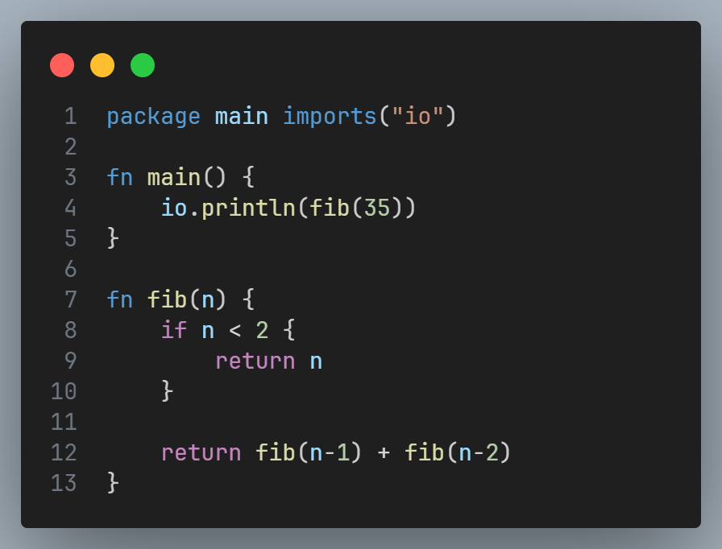
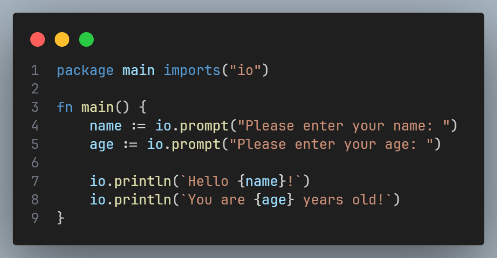
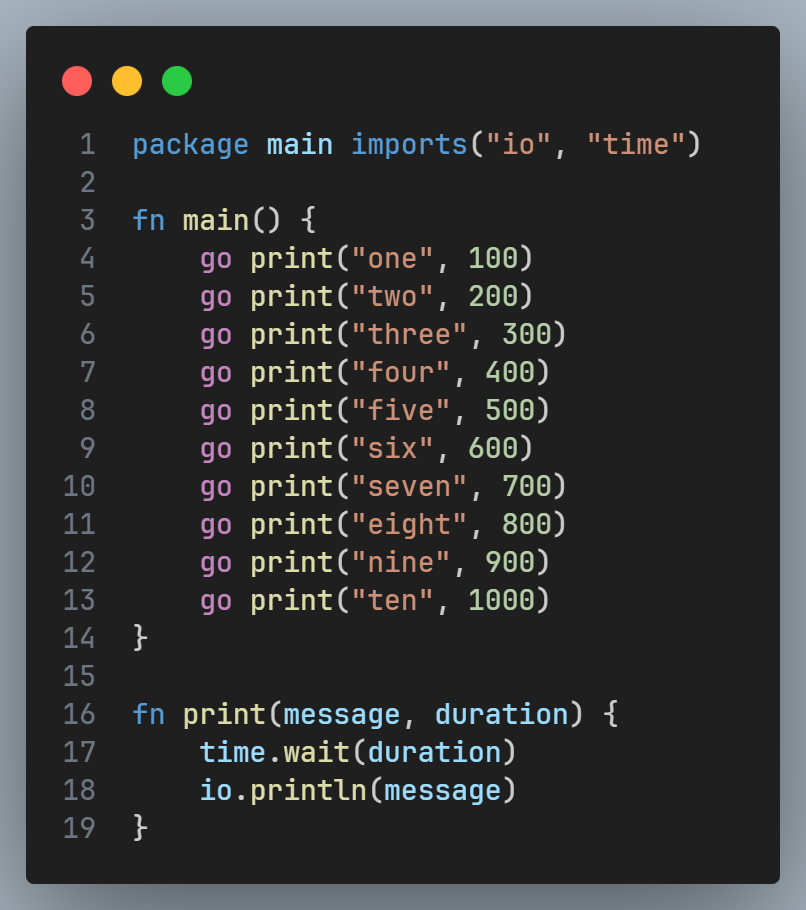

# The Evie Programming Language

Evie is a lightweight, dynamically typed scripting language written in pure Go without CGO. Combining the dynamic ergonomics of JavaScript and Python with Go's simplicity and Rust's safe-by-default immutability, Evie features cooperative fibers with `go` and `await`, first-class OOP with structs and inheritance, and seamless Go host embedding.

Preliminary micro-benchmarks show Evie to be faster than PUC [Lua 5.4.2](https://lua.org/) and Google's [V8 Ignition](https://v8.dev/docs/ignition) JavaScript interpreter. See [here](#benchmarks).

---

## Showcase

#### Recursive Fibonacci ([examples/fib.ev](./examples/fib.ev))
<!-- TODO: Replace this image -->
<a href="./examples/fib.ev">
    
</a>

#### String Interpolation & I/O ([examples/input.ev](./examples/input.ev))
<!-- TODO: Replace this image -->
<a href="./examples/input.ev">
    
</a>

#### Concurrent Tasks with `go` ([examples/go.ev](./examples/go.ev))
<!-- TODO: Replace this image -->
<a href="./examples/go.ev">
    
</a>

Tasks spawned with `go` run as fibers of the instance and return stateful, memoized `Task` handles that can be awaited (`await task`, `await.all`, `await.any`, `await.race`). Only one fiber of an instance executes Evie code at a time; a fiber hands over at `await` and inside blocking host functions such as `time.wait`, so shared state never needs locking and a script can never race.

To test this program, run `go run ./evie -t ./examples/go.ev`.

> The flag `-t` prints the execution time of just Evie, i.e. total time minus the time it took to compile Evie itself.

#### Shared state without locks ([examples/race.ev](./examples/race.ev))

Two tasks incrementing one global always end at the exact total, because fibers of an instance interleave only at `await` and in blocking host calls. To use several CPU cores, a host creates several instances; each has its own heap and nothing is shared between them.

---

## Key Features

- **Cooperative & Expressive Concurrency**:
  - `go` spawns concurrent fibers returning stateful `Task` instances.
  - `await` pauses the fiber until task resolution with multi-await memoization.
  - Multi-task coordination via `await.all()`, `await.any()`, and `await.race()`.
- **One Running Fiber per Instance**:
  - Fibers hand over at `await` and inside blocking host functions, so arrays, objects, structs and globals need no locks and cannot race.
  - Parallelism across instances: every `vm.Instance` has its own runner and heap.
- **Safe-by-Default Immutability**:
  - `x := 10` creates an immutable binding.
  - `var x := 10` is explicitly required for mutability.
- **First-Class Structs & OOP**:
  - Encapsulated methods with implicit `this`.
  - Classical single inheritance (`struct Sub : Super { ... }`).
  - Dynamic instance fields (`p.email = "..."`).
  - First-class bound methods (`fnVal := p.greet`).
  - Polymorphic type checks (`p is Person`, `dog is Animal`).
- **Modern Control Flow & Iteration**:
  - `if`, `else`, `while`, `break`, and `continue`.
  - `for item in collection` and `for idx, item in collection` over arrays, objects, and strings.
- **Robust Error Handling**:
  - `throw error("...")` and `catch(expr)` semantics with first-class `error` values that know their file, line, column and call trace.
  - Compiler-grade diagnostics: every error shows the offending line with the span underlined, related places, a hint, and suggestions for misspelled names.
- **High-Performance NaN-Boxing**:
  - 64-bit NaN-boxed `Value` representation (`number`, `bool`, `string`, `buffer`, `array`, `object`, `struct`, `task`, `error`, `function`, `nil`).
- **Seamless Go Host Embedding**:
  - Automatic Go function reflection wrapping (`env.Set("fn", goFunc)`).
  - Bidirectional marshaling and unmarshaling into native Go structs (`val.Unmarshal(&struct)`).
  - One-line script execution (`evie.Eval(...)`).
  - Stopping runaway scripts with `Interrupt()` or a context deadline, without the script being able to catch it.
- **Pure Go (Zero CGO)**:
  - 100% Go codebase, fast builds, effortless cross-compilation, and zero external dependencies.

---

## Go Host Embedding Example

Embedding Evie in your Go application requires no CGO or complicated bindings:

```go
package main

import (
    "fmt"
    "github.com/hxkhan/evie"
    "github.com/hxkhan/evie/vm"
)

func main() {
    // 1. A host package the script can import. Func1 wraps a Go function without reflection.
    api := vm.NewPackage("api")
    api.Native("fetchData", vm.Func1(func(id int) map[string]any {
        return map[string]any{"id": id, "status": "active"}
    }))

    // 2. An engine with the standard library and the host package
    eng := evie.New(evie.Options{Packages: []*vm.Package{api}})

    // 3. Load a script
    _, err := eng.Eval(`package main imports("api")
        fn status(id) {
            data := api.fetchData(id)
            return data.status
        }`)
    if err != nil {
        panic(err)
    }

    // 4. Call into it with Go arguments; evie.Format prints an error the way the CLI does
    val, err := eng.Call("main.status", 42)
    if err != nil {
        fmt.Print(evie.Format(err, false))
    }
    fmt.Println(val) // active

    // 5. One-line evaluation
    result, _ := evie.Eval("return [1, 2, 3].len() * 10")
    fmt.Println(result) // 30
}
```

Natives can also be written against the call context directly, which is the fastest path and gives full control over argument checking:

```go
pkg.Func("wait", 1, func(c vm.Call) (vm.Value, error) {
    ms, err := c.Number(0) // "wait: argument 1 must be a number, got string"
    if err != nil {
        return vm.Value{}, err
    }
    select {
    case <-time.After(time.Duration(ms) * time.Millisecond):
        return vm.Value{}, nil
    case <-c.Context().Done(): // the script was stopped
        return vm.Value{}, context.Cause(c.Context())
    }
}).Blocking = true // gives the instance to other fibers while it sleeps
```

Runaway scripts can be stopped from any goroutine with `eng.Interrupt()`, or bounded by a context:

```go
ctx, cancel := context.WithTimeout(context.Background(), 2*time.Second)
defer cancel()
_, err := eng.CallContext(ctx, "main.status", 42) // errors.Is(err, context.DeadlineExceeded) after 2s
```

---

## Features Checklist

- [x] Variables & Immutability (`:=` vs `var :=`)
- [x] Functions, Closures & Variadic Arguments (`...args`)
- [x] Primitive types (`number`, `bool`, `nil`)
- [x] Reference types (`string`, `buffer`, `array`, `object`, `function`, `task`, `error`)
- [x] Structs & OOP (methods, `this`, single inheritance, dynamic fields, bound methods)
- [x] Control flow (`if`, `else`, `while`, `break`, `continue`)
- [x] For loops (`for item in col`, `for idx, item in col`)
- [x] Operators (`+`, `-`, `*`, `/`, `%`, `==`, `!=`, `<`, `<=`, `>`, `>=`, `?`)
- [x] Logical operators (`!`, `&&`, `||`)
- [x] Type checking (`is` operator)
- [x] Concurrency (`go`, `await`, `await.all`, `await.any`, `await.race`, `Task`)
- [x] One running fiber per instance (no locks, no data races, cooperative await)
- [x] Scoping (global, package, function, block, captured closures)
- [x] Error handling (`throw`, `catch(expr)`, `error` type)
- [x] Go Host Embedding (bidirectional marshaling, function reflection, struct unmarshaling)
- [x] Standard library (`io`, `fs`, `math`, `strings`, `time`, `json`)
- [x] Compiler-style diagnostics (source excerpts, spans, hints, did-you-mean, stack traces)
- [x] Interrupts and deadlines for runaway scripts (`Interrupt`, `RunFileContext`, `CallContext`)
- [ ] Package management ⏳

---

## Documentation

For a comprehensive guide covering grammar, types, standard methods, and concurrency patterns, see:
- [Language Reference (docs/syntax.md)](./docs/syntax.md)

---

## Benchmarks

| Language | fib(35)  | Host Language |
| :-       | :-       | :-            |
| [**Evie**](https://github.com/hxkhan/evie) | `457ms` | Go |
| [PUC Lua 5.4.2](https://lua.org/) | `587ms` | C |
| [JS - QuickJS](https://bellard.org/quickjs/) | `693ms` | C |
| [JS - V8 Ignition](https://v8.dev/docs/ignition) (`node --jitless`) | `779ms` | C++ |
| [Python 3.13](https://python.org/) | `983ms` | C |
| [Wren](https://wren.io/) | `1030ms` | C |
| [Tengo](https://github.com/d5/tengo) | `1826ms` | Go |

> Measured on an Intel i5-13400F under Windows 11 with the programs in [examples/](./examples) (`fib.ev`, `fib.lua`, `fib.js`, ...). Each figure is the median wall time of five runs after a warm-up, process start included.

The [benchmark suite](./benchmarks) tracks 30 programs covering calls, closures, structs, method dispatch, host calls, strings, objects, errors and tasks; [results/latest.md](./benchmarks/results/latest.md) has the current numbers.

Why `fib(35)`? Because micro-benchmarks measure fundamental VM metrics:
- Function invocation and call-frame overhead (`29,860,703` recursive calls)
- Bytecode instruction dispatch performance
- Primitive number crunching
- Conditional branch prediction

---

## Setup & Quick Start

### Prerequisites
- Go 1.26+ installed ([go.dev/doc/install](https://go.dev/doc/install))

### Build & Run
```bash
# Clone the repository
git clone https://github.com/hxkhan/evie.git
cd evie

# Build the CLI executable
go build ./evie

# Run an example
./evie ./examples/fib.ev

# Run code without a file; the standard packages it names are imported for it
./evie -e 'math.sqrt(2)'
./evie -e 'for w in strings.fields("go evie go") { io.println(strings.upper(w)) }'

# Print the version, or the commit the binary was built from
./evie --version
```

### Run Tests
```bash
go test -v .
go vet ./...
```
