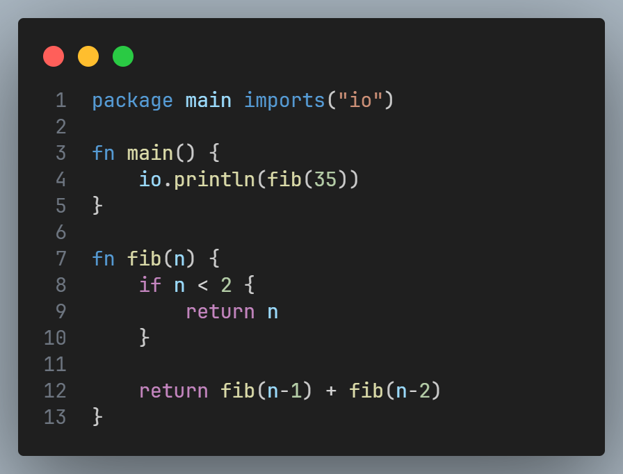
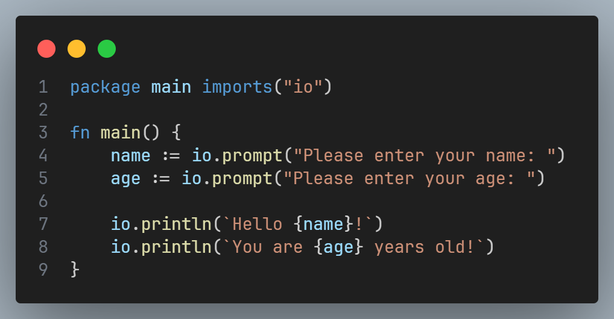
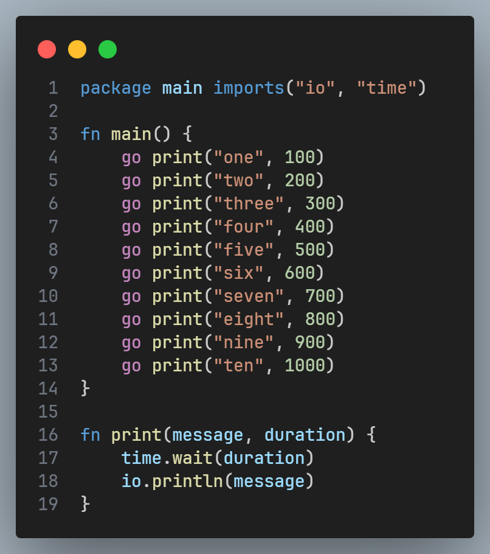

# The Evie Programming Language

Evie is a lightweight, dynamically typed scripting language written in pure Go without CGO. Combining the dynamic ergonomics of JavaScript and Python with Go's simplicity and Rust's safe-by-default immutability, Evie features cooperative fibers with `go` and `await`, first-class OOP with classes and inheritance, and seamless Go host embedding.

On an eight-workload cross-language suite, Evie is the fastest of the languages a Go program can embed: 3 to 10 times faster than [Kavun](https://github.com/jokruger/kavun), [gopher-lua](https://github.com/yuin/gopher-lua), [Tengo](https://github.com/d5/tengo), [Starlark](https://github.com/google/starlark-go), [goja](https://github.com/dop251/goja) and [Yaegi](https://github.com/traefik/yaegi). It is also slightly faster overall than PUC [Lua 5.4](https://lua.org/), written in C, and about twice as fast as Google's [V8 Ignition](https://v8.dev/docs/ignition) JavaScript interpreter. See [here](#benchmarks).

---

## Showcase

#### Recursive Fibonacci ([examples/fib.ev](./examples/fib.ev))
<a href="./examples/fib.ev">
    
</a>

#### String Interpolation & I/O ([examples/input.ev](./examples/input.ev))
<a href="./examples/input.ev">
    
</a>

#### Concurrent Tasks with `go` ([examples/go.ev](./examples/go.ev))
<a href="./examples/go.ev">
    
</a>

Tasks spawned with `go` run as fibers of the instance and return stateful, memoized `Task` handles that can be awaited (`await task`, `await.all`, `await.any`, `await.race`, `await.timeout`) or cancelled (`task.cancel()`). Only one fiber of an instance executes Evie code at a time; a fiber hands over at `await` and inside blocking host functions such as `time.wait`, so shared state never needs locking and a script can never race.

To test this program, run `go run ./evie -t ./examples/go.ev`.

> The flag `-t` prints how long the program took, parsing and compiling included.

#### Shared state without locks ([examples/race.ev](./examples/race.ev))

Two tasks incrementing one global always end at the exact total, because fibers of an instance interleave only at `await` and in blocking host calls. To use several CPU cores, a host creates several instances; each has its own heap and nothing is shared between them.

---

## Key Features

- **Cooperative & Expressive Concurrency**:
  - `go` spawns concurrent fibers returning stateful `Task` instances.
  - `await` pauses the fiber until task resolution with multi-await memoization.
  - Multi-task coordination, deadlines, and cancellation via `await.all()`, `await.any()`, `await.race()`, `await.timeout()`, and `task.cancel()`.
- **One Running Fiber per Instance**:
  - Fibers hand over at `await` and inside blocking host functions, so arrays, objects, classes and globals need no locks and cannot race.
  - Parallelism across instances: every `vm.Instance` has its own runner and heap.
- **Safe-by-Default Immutability**:
  - `x := 10` creates an immutable binding.
  - `var x := 10` is explicitly required for mutability.
- **First-Class Classes & OOP**:
  - Fixed-shape classes with declared body fields (`field := ...` immutable, `var field := ...` mutable) and per-instance initializers.
  - Encapsulated methods with implicit `this`.
  - Classical single inheritance (`class Sub : Super { ... }`) with `super.method()` calls.
  - First-class bound methods (`fnVal := p.greet`).
  - Polymorphic type checks (`p is Person`, `dog is Animal`).
- **Modern Control Flow & Collections**:
  - `if`, `else`, `switch`, `while`, `break`, and `continue`.
  - `for item in collection` and `for idx, item in collection` over arrays, objects, strings, and buffers.
  - Indexing and slicing (`arr[a:b]`, `str[a:b]`, `buf[a:b]`) with UTF-8 character semantics on strings.
- **Robust Error Handling**:
  - `throw` and `catch(expr)` or `catch { ... }` with first-class `error` values: a message, a kind such as `"notFound"` or `"timeout"` to tell failures apart, any fields and a cause, and the file, line, column and call trace.
  - Compiler-grade diagnostics: every error shows the offending line with the span underlined, related places, a hint, and suggestions for misspelled names.
- **Compact 16-Byte Tagged Value**:
  - Compact 16-byte tagged `Value` (`uint64` + `unsafe.Pointer`) storing `number`, `bool`, and `nil` inline without heap allocation (`number`, `bool`, `string`, `buffer`, `array`, `object`, `class`, `task`, `error`, `function`, `nil`).
- **Seamless Go Host Embedding**:
  - Go functions become natives through typed wrappers (`vm.Func1(goFunc)`) or reflection (`vm.Reflect(goFunc)`).
  - Bidirectional marshaling and unmarshaling into native Go structs (`val.Unmarshal(&struct)`, `json.Marshal(val)`).
  - Per-engine stdlib sandboxing (`Options.Stdlib`, `Options.NoStdlib`), virtual/embedded filesystems (`Options.FS` confines imports and the `fs` package, which can then only read from it), and custom I/O streams (`Options.Stdin`, `Options.Stdout`).
  - Parse once, run anywhere: `evie.ParseFile`, `ParseProject` and `ParseSource` produce an immutable `*evie.Bundle` that `eng.RunBundle` runs in any number of independent engines at once.
  - One-line script execution (`evie.Eval(...)`).
  - Stopping runaway scripts with `Interrupt()` or a context deadline, without the script being able to catch it.
- **Pure Go (Zero CGO)**:
  - 100% Go codebase, fast builds, effortless cross-compilation, and zero external dependencies.

---

## Go Host Embedding Example

Embedding Evie in your Go application requires no CGO or complicated bindings:

```go
package main

import (
    "fmt"
    "github.com/hxkhan/evie"
    "github.com/hxkhan/evie/vm"
)

func main() {
    // 1. A host package the script can import. Func1 wraps a Go function without reflection.
    api := vm.NewPackage("api")
    api.Native("fetchData", vm.Func1(func(id int) map[string]any {
        return map[string]any{"id": id, "status": "active"}
    }))

    // 2. An engine with the standard library and the host package
    eng := evie.New(evie.Options{Packages: []*vm.Package{api}})
    defer eng.Close()

    // 3. Load a script
    _, err := eng.Eval(`package main imports("api")
        fn status(id) {
            data := api.fetchData(id)
            return data.status
        }`)
    if err != nil {
        panic(err)
    }

    // 4. Call into it with Go arguments; evie.Format prints an error the way the CLI does
    val, err := eng.Call("main.status", 42)
    if err != nil {
        fmt.Print(evie.Format(err, false))
    }
    fmt.Println(val) // active

    // 5. One-line evaluation
    result, _ := evie.Eval("return [1, 2, 3].len() * 10")
    fmt.Println(result) // 30
}
```

Natives can also be written against the call context directly, which is the fastest path and gives full control over argument checking (use `c.Async` for background tasks tied to the engine's lifecycle):

```go
pkg.Func("wait", 1, func(c vm.Call) (vm.Value, error) {
    ms, err := c.Number(0) // "wait: argument 1 must be a number, got string"
    if err != nil {
        return vm.Value{}, err
    }
    timer := time.NewTimer(time.Duration(ms) * time.Millisecond)
    defer timer.Stop()
    select {
    case <-timer.C:
        return vm.Value{}, nil
    case <-c.Context().Done(): // the script was stopped
        return vm.Value{}, context.Cause(c.Context())
    }
}).Blocking = true // gives the instance to other fibers while it sleeps
```

Runaway scripts can be stopped from any goroutine with `eng.Interrupt()`, or bounded by a context:

```go
ctx, cancel := context.WithTimeout(context.Background(), 2*time.Second)
defer cancel()
_, err := eng.CallContext(ctx, "main.status", 42) // errors.Is(err, context.DeadlineExceeded) after 2s
```

---

## Features Checklist

- [x] Variables & Immutability (`:=` vs `var :=`)
- [x] Functions, Closures & Variadic Arguments (`...args`)
- [x] Primitive types (`number`, `bool`, `nil`)
- [x] Reference types (`string`, `buffer`, `array`, `object`, `function`, `task`, `error`)
- [x] Classes & OOP (fixed-shape layout, body fields, methods, `this`, single inheritance, `super`, bound methods)
- [x] Control flow (`if`, `else`, `switch`, `while`, `break`, `continue`)
- [x] For loops (`for item in col`, `for idx, item in col`) & slicing (`arr[a:b]`, `str[a:b]`, `buf[a:b]`)
- [x] Operators (`+`, `-`, `*`, `/`, `%`, `==`, `!=`, `<`, `<=`, `>`, `>=`, `?`)
- [x] Logical operators (`!`, `&&`, `||`)
- [x] Type checking (`is` operator)
- [x] Concurrency (`go`, `await`, `await.all`, `await.any`, `await.race`, `await.timeout`, `Task`, `task.cancel`)
- [x] One running fiber per instance (no locks, no data races, cooperative await)
- [x] Scoping (global, package, function, block, captured closures)
- [x] Error handling (`throw`, `catch`, `error` values with kinds, fields and causes)
- [x] Go Host Embedding (bidirectional marshaling, function reflection, struct unmarshaling, stdlib sandboxing, custom I/O)
- [x] Standard library (`io`, `fs`, `math`, `time`, `json`)
- [x] Compiler-style diagnostics (source excerpts, spans, hints, did-you-mean, stack traces)
- [x] Interrupts and deadlines for runaway scripts (`Interrupt`, `RunFileContext`, `CallContext`)
- [x] Interactive REPL (`evie` with multi-line input, persistent `vm.Session` state, and `:help` commands)
- [ ] Package management ⏳

---

## Documentation

For a comprehensive guide covering grammar, types, standard methods, and concurrency patterns, see:
- [Language Reference (docs/syntax.md)](./docs/syntax.md)

---

## Benchmarks

Across the 8-workload checksum-verified [cross-language suite](./benchmarks/compare) (median wall time of 5 runs after 1 warm-up on P-cores, process startup included). Every program must print the same checksum in every language, so a broken port fails instead of posting a time.

**Languages you can embed in Go.** Evie is the fastest on every benchmark:

| Benchmark | **Evie** | Kavun | gopher-lua | Tengo | Starlark | goja (JS) | Yaegi (Go) |
| :- | -: | -: | -: | -: | -: | -: | -: |
| `classes` | **30.7ms** | 101.7ms | 161.0ms | 135.0ms | 217.5ms | 176.2ms | 1.58s |
| `closures` | **32.9ms** | 79.6ms | 194.9ms | 124.3ms | 265.8ms | 188.3ms | 894.4ms |
| `fib` | **319.9ms** | 1.26s | 1.65s | 1.65s | 4.53s | 2.44s | 20.45s |
| `mandelbrot` | **76.4ms** | 300.1ms | 262.7ms | 532.4ms | 716.7ms | 1.13s | 459.8ms |
| `matmul` | **36.4ms** | 118.0ms | 104.8ms | 192.8ms | 247.0ms | 246.6ms | 194.8ms |
| `objects` | **32.8ms** | 63.7ms | 99.5ms | 105.5ms | 100.6ms | 130.5ms | 108.2ms |
| `sieve` | **58.1ms** | 194.8ms | 203.5ms | 390.8ms | 413.2ms | 561.9ms | 342.8ms |
| `strings` | **37.3ms** | 95.4ms | 269.5ms | 82.6ms | 59.9ms | 91.0ms | 87.8ms |
| **Geomean** | **53.2ms** | **159.9ms** | **229.8ms** | **236.2ms** | **321.9ms** | **332.7ms** | **550.4ms** |
| **vs Evie** | **1.00x** | **3.01x** | **4.32x** | **4.44x** | **6.05x** | **6.26x** | **10.35x** |

**Interpreters written in C and C++.** Evie is slightly ahead of Lua 5.4 overall, though Lua still wins numeric loops and big dictionaries:

| Benchmark | **Evie** (Go) | Lua 5.4 (C) | QuickJS (C) | Python 3 (C) | V8 `--jitless` (C++) | Wren (C) |
| :- | -: | -: | -: | -: | -: | -: |
| `classes` | **30.7ms** | 36.3ms | 45.0ms | 67.9ms | 72.4ms | 52.9ms |
| `closures` | **32.9ms** | 33.9ms | 47.7ms | 83.9ms | 78.3ms | 74.7ms |
| `fib` | **319.9ms** | 414.6ms | 586.0ms | 848.2ms | 625.2ms | 894.6ms |
| `mandelbrot` | 76.4ms | **59.1ms** | 142.7ms | 212.3ms | 158.7ms | 228.2ms |
| `matmul` | 36.4ms | **26.6ms** | 58.8ms | 79.5ms | 91.5ms | 125.0ms |
| `objects` | 32.8ms | **21.9ms** | 37.7ms | 49.6ms | 67.1ms | 58.2ms |
| `sieve` | 58.1ms | **51.5ms** | 100.7ms | 126.7ms | 118.1ms | 147.2ms |
| `strings` | **37.3ms** | 84.8ms | 40.6ms | 39.4ms | 77.0ms | 327.0ms |
| **Geomean** | **53.2ms** | **54.4ms** | **79.7ms** | **109.2ms** | **115.4ms** | **151.8ms** |
| **vs Evie** | **1.00x** | **1.02x** | **1.50x** | **2.05x** | **2.17x** | **2.86x** |

> Measured on an Intel i5-13400F under Windows 11 (`.\benchmarks\compare\bench.ps1 -Runs 5 -Warmup 1 -Affinity 0x0FFF`). `>1.00x` means Evie is faster.

The internal [benchmark suite](./benchmarks) tracks 30 programs covering calls, closures, classes, method dispatch, host calls, strings, objects, errors and tasks; [results/latest.md](./benchmarks/results/latest.md) has the current numbers.

---

## Setup & Quick Start

### Prerequisites
- Go 1.27+ installed ([go.dev/doc/install](https://go.dev/doc/install))

### Install or Build
```bash
# Install the CLI directly with Go
go install github.com/hxkhan/evie/evie@latest

# Or clone and build from source
git clone https://github.com/hxkhan/evie.git
cd evie
go build ./evie

# Start an interactive REPL (multi-line input, persistent state, :help for commands)
./evie

# Run an example
./evie ./examples/fib.ev

# Ctrl+C stops a running script with an error that shows where it was; press it again to exit at once

# Run code without a file; the standard packages it names are imported for it
./evie -e 'math.sqrt(2)'
./evie -e 'for w in "go evie go".fields() { io.println(w.toUpper()) }'

# Inspect compiled packages, globals, classes, slots, escapes and closure captures without running main
./evie -dump ./examples/captures.ev

# Report syntax and compile errors without running anything; exit status 1 when there are any
./evie -check ./examples/fib.ev

# Print the version (also -v), or the commit the binary was built from
./evie --version
```

### Editor Support
The VS Code extension in [extensions/vscode](./extensions/vscode) shows errors as you type, and offers go to definition, find all references, hover, completion and an outline. Its analysis is Evie's own compiler, compiled to WebAssembly, so it needs nothing else installed. Build it with `npm install && npm run package` in that folder, then install the `.vsix`. Other tools can use the [analysis](./analysis) package directly.

### Run Tests
```bash
go test ./...
go vet ./...
```

---

## License

Licensed under the [Apache License, Version 2.0](./LICENSE). See [NOTICE](./NOTICE) for attribution details.
