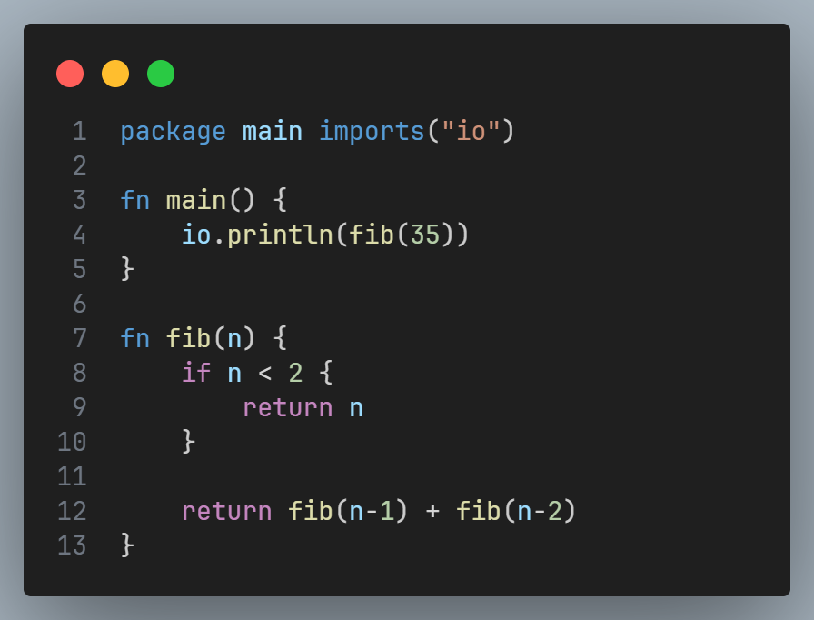
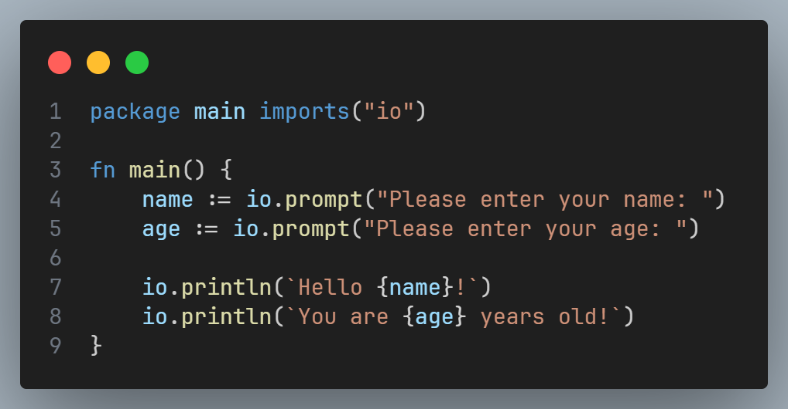
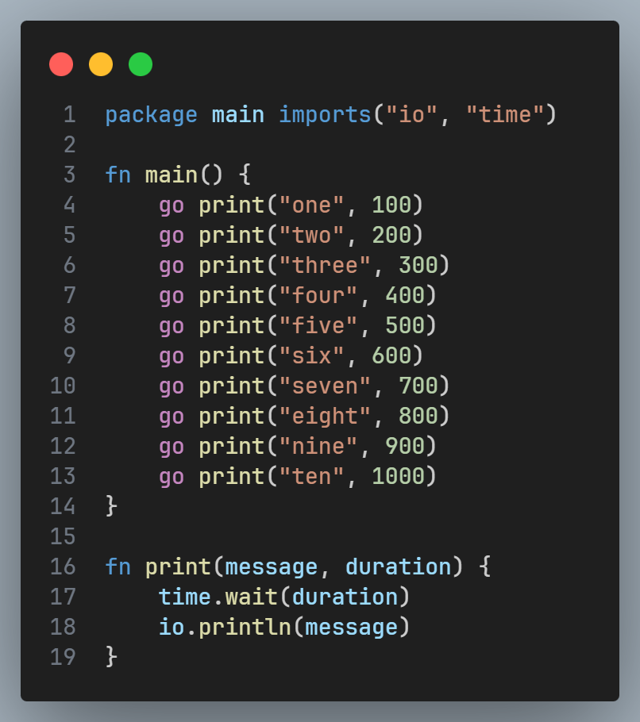
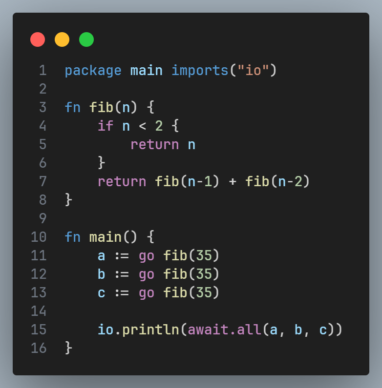

# The Evie Programming Language

Evie is a lightweight, dynamically typed, multi-threaded scripting language written in pure Go without CGO. Combining the dynamic ergonomics of JavaScript and Python with Go's simplicity and Rust's safe-by-default immutability, Evie features true multi-core parallel concurrency, cooperative fibers, first-class OOP with structs and inheritance, and seamless Go host embedding.

Preliminary micro-benchmarks show Evie to be faster than PUC [Lua 5.4.2](https://lua.org/) and Google's [V8 Ignition](https://v8.dev/docs/ignition) JavaScript interpreter. See [here](#benchmarks).

---

## Showcase

#### Recursive Fibonacci ([examples/fib.ev](./examples/fib.ev))
<!-- TODO: Replace this image -->
<a href="./examples/fib.ev">
    
</a>

#### String Interpolation & I/O ([examples/input.ev](./examples/input.ev))
<!-- TODO: Replace this image -->
<a href="./examples/input.ev">
    
</a>

#### Concurrent Tasks with `go` ([examples/go.ev](./examples/go.ev))
<!-- TODO: Replace this image -->
<a href="./examples/go.ev">
    
</a>

Evie fibers run in true parallel multi-threading across OS threads and CPU cores without a Global Interpreter Lock by default (`UndefinedMode`). Tasks spawned with `go` return stateful, memoized `Task` handles that can be awaited (`await task`, `await.all`, `await.any`, `await.race`).

To test this program, run `go run ./evie -t ./examples/go.ev`.

> The flag `-t` prints the execution time of just Evie, i.e. total time minus the time it took to compile Evie itself.

#### Multi-Core Parallelism & Synchronization ([examples/unsynced.ev](./examples/unsynced.ev))
<a href="./examples/unsynced.ev">
    
</a>

Unlike Python's default GIL, Evie executes CPU-bound fibers simultaneously across multiple CPU cores out of the box. When mutual exclusion is required for shared mutable state, Evie provides fine-grained `synced` blocks (`synced { ... }`) and `synced` functions (`fn foo() synced { ... }`) to serialize critical sections under the runtime GIL without serializing unaffected code.

---

## Key Features

- **Parallel by Default**: Multi-threaded fibers execute simultaneously across CPU cores with zero GIL contention by default.
- **Cooperative & Expressive Concurrency**:
  - `go` spawns concurrent fibers returning stateful `Task` instances.
  - `await` pauses the fiber until task resolution with multi-await memoization.
  - Multi-task coordination via `await.all()`, `await.any()`, and `await.race()`.
- **Fine-Grained Critical Sections (`synced`)**:
  - Re-entrant `synced { ... }` blocks and `fn ... synced` functions for thread-safe mutations.
  - Cooperative lock-releasing: awaiting a task inside `synced` code automatically releases the GIL while waiting and re-acquires it on resume.
- **Internal Struct Thread-Safety**:
  - Struct instances are internally synchronized using per-instance `sync.RWMutex` locks, preventing low-level data races on field reads and mutations.
  - Struct methods run in parallel by default across CPU cores.
- **Safe-by-Default Immutability**:
  - `x := 10` creates an immutable binding.
  - `var x := 10` is explicitly required for mutability.
- **First-Class Structs & OOP**:
  - Encapsulated methods with implicit `this`.
  - Classical single inheritance (`struct Sub : Super { ... }`).
  - Dynamic instance fields (`p.email = "..."`).
  - First-class bound methods (`fnVal := p.greet`).
  - Polymorphic type checks (`p is Person`, `dog is Animal`).
- **Modern Control Flow & Iteration**:
  - `if`, `else`, `while`, `break`, and `continue`.
  - `for item in collection` and `for idx, item in collection` over arrays, objects, and strings.
- **Robust Error Handling**:
  - `throw error("...")` and `catch(expr)` semantics with first-class `error` values.
- **High-Performance NaN-Boxing**:
  - 64-bit NaN-boxed `Value` representation (`number`, `bool`, `string`, `buffer`, `array`, `object`, `struct`, `task`, `error`, `function`, `nil`).
- **Seamless Go Host Embedding**:
  - Automatic Go function reflection wrapping (`env.Set("fn", goFunc)`).
  - Bidirectional marshaling and unmarshaling into native Go structs (`val.Unmarshal(&struct)`).
  - One-line script execution (`evie.Eval(...)`).
- **Pure Go (Zero CGO)**:
  - 100% Go codebase, fast builds, effortless cross-compilation, and zero external dependencies.

---

## Go Host Embedding Example

Embedding Evie in your Go application requires no CGO or complicated bindings:

```go
package main

import (
    "fmt"
    "github.com/hxkhan/evie"
)

func main() {
    // 1. Create a new Evie environment
    env := evie.New()

    // 2. Expose Go functions directly via reflection
    env.Set("fetchData", func(id float64) map[string]any {
        return map[string]any{
            "id":     id,
            "status": "active",
        }
    })

    // 3. Execute Evie script
    val, err := env.Run(`
        package main
        fn main() {
            data := fetchData(42)
            return data["status"]
        }
    `)
    if err != nil {
        panic(err)
    }

    fmt.Println(val.ToGo()) // "active"

    // 4. One-line evaluation
    result, _ := evie.Eval("return [1, 2, 3].len() * 10")
    fmt.Println(result.ToGo()) // 30
}
```

---

## Features Checklist

- [x] Variables & Immutability (`:=` vs `var :=`)
- [x] Functions, Closures & Variadic Arguments (`...args`)
- [x] Primitive types (`number`, `bool`, `nil`)
- [x] Reference types (`string`, `buffer`, `array`, `object`, `function`, `task`, `error`)
- [x] Structs & OOP (methods, `this`, single inheritance, dynamic fields, bound methods)
- [x] Struct thread-safety (per-instance `sync.RWMutex`, parallel methods by default)
- [x] Control flow (`if`, `else`, `while`, `break`, `continue`)
- [x] For loops (`for item in col`, `for idx, item in col`)
- [x] Operators (`+`, `-`, `*`, `/`, `%`, `==`, `!=`, `<`, `<=`, `>`, `>=`, `?`)
- [x] Logical operators (`!`, `&&`, `||`)
- [x] Type checking (`is` operator)
- [x] Concurrency (`go`, `await`, `await.all`, `await.any`, `await.race`, `Task`)
- [x] Synchronization (`synced` blocks, `synced` functions, re-entrancy, cooperative await)
- [x] Scoping (global, package, function, block, captured closures)
- [x] Error handling (`throw`, `catch(expr)`, `error` type)
- [x] Go Host Embedding (bidirectional marshaling, function reflection, struct unmarshaling)
- [ ] Package management / module imports ⏳
- [ ] Standard library expansion (`std/json`, `std/math`, `std/fs`) ⏳

---

## Documentation

For a comprehensive guide covering grammar, types, standard methods, and concurrency patterns, see:
- [Language Reference (docs/syntax.md)](./docs/syntax.md)

---

## Benchmarks

| Language | fib(35)  | Host Language |
| :-       | :-       | :-            |
| [**Evie**](https://github.com/hxkhan/evie) | `392ms` | Go |
| [PUC Lua 5.4.2](https://lua.org/) | `507ms` | C | 
| [JS - V8 Ignition](https://v8.dev/docs/ignition) | `665ms` | C++ | 
| [JS - QuickJS](https://bellard.org/quickjs/) | `703ms` | C | 
| [Python 3.13](https://python.org/) | `826ms` | C |
| [Wren](https://wren.io/) | `893ms` | C |
| [Tengo](https://github.com/d5/tengo) | `1603ms` | Go |

> Benchmarks ran on an Intel i5-13400F. Each language was executed 10 times and the average was recorded.

Why `fib(35)`? Because micro-benchmarks measure fundamental VM metrics:
- Function invocation and call-frame overhead (`29,860,703` recursive calls)
- Bytecode instruction dispatch performance
- Primitive number crunching
- Conditional branch prediction

---

## Setup & Quick Start

### Prerequisites
- Go 1.20+ installed ([go.dev/doc/install](https://go.dev/doc/install))

### Build & Run
```bash
# Clone the repository
git clone https://github.com/hxkhan/evie.git
cd evie

# Build the CLI executable
go build ./evie

# Run an example
./evie ./examples/fib.ev
```

### Run Tests
```bash
go test -v .
go vet ./...
```
